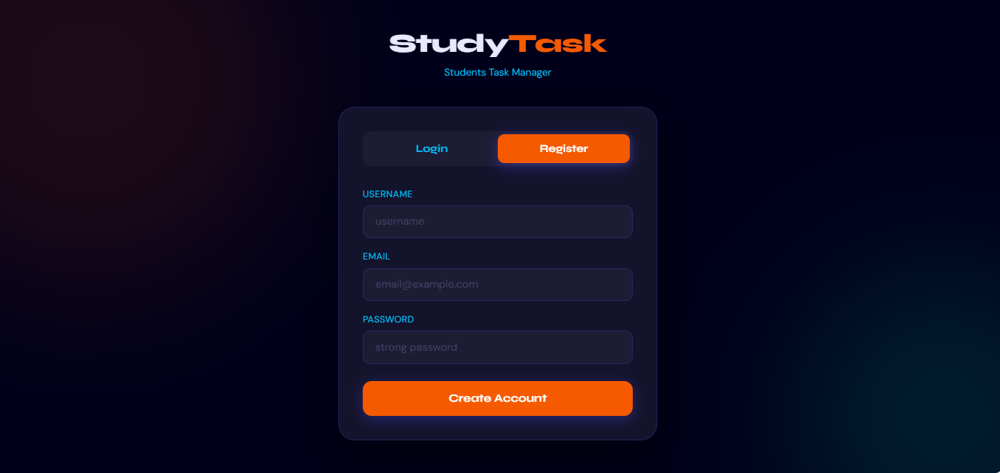
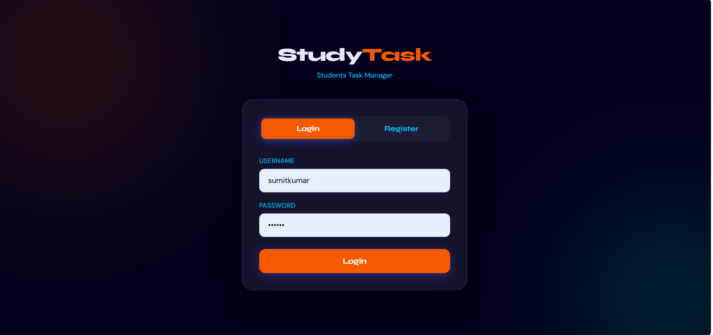
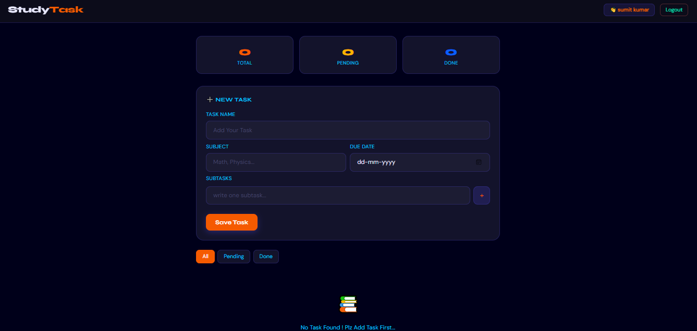

# 📚 StudyTask — Students Task Manager

A full-stack web app that helps students manage their tasks and subtasks. Django REST API backend with a vanilla HTML/CSS/JS frontend, served by Django itself.

---

## 🛠️ Tech Stack

| Part | Technology |
|------|-----------|
| Frontend | HTML, CSS, Vanilla JavaScript (`templates/index.html`) |
| Backend | Django + Django REST Framework |
| Database | PostgreSQL |
| Authentication | Token Authentication |
| Server | Gunicorn + WhiteNoise |
| Containers | Docker, Docker Compose |
| Fonts | Google Fonts (Syne, DM Sans) |

---

## ✨ Features

- 🔐 User Registration & Login (Token-based auth)
- ✅ Add, delete, and toggle tasks complete/incomplete
- 📋 Subtasks — create subtasks inside each task
- 📊 Progress bar — tracks subtask completion
- 🔍 Filter tasks — All / Pending / Done
- 📈 Stats panel — Total, Pending, Done count
- 🔔 Toast notifications for all actions
- 💾 Token saved in LocalStorage (stays logged in on reload)

---

## 📁 Project Structure

```
student-task-portal/
│
├── Task/                     # Django app
│   ├── models.py             # Task, Subtask models
│   ├── serializers.py        # DRF serializers
│   ├── views.py              # Auth + Task/Subtask API views
│   └── urls.py               # API routes (mounted at /api/)
│
├── study_task/               # Django project
│   ├── settings.py
│   └── urls.py
│
├── templates/
│   └── index.html            # Complete frontend (single file, served at /)
├── screenshots/
├── Dockerfile / docker-compose.yml
├── requirements.txt
└── manage.py
```

---

## ⚙️ Environment Variables

Create a `.env` file in the project root (it is not committed):

```env
SECRET_KEY=your-secret-key
DEBUG=True
DB_NAME=study_db
DB_USER=your_db_user
DB_PASSWORD=your_db_password
DB_HOST=localhost        # use "db" when running with Docker Compose
DB_PORT=5432
```

---

## ▶️ Run Locally

```bash
python -m venv venv
source venv/bin/activate        # Linux/Mac
venv\Scripts\activate           # Windows

pip install -r requirements.txt
python manage.py migrate
python manage.py runserver
```

Open `http://127.0.0.1:8000/` — the frontend is served by Django, no separate build step.

PostgreSQL must be running and match the `DB_*` values in `.env`.

---

## 🐳 Run with Docker

```bash
docker compose up --build
docker compose exec web python manage.py migrate
```

- Set `DB_HOST=db` in `.env`, and make `DB_NAME`, `DB_USER`, `DB_PASSWORD` match the `POSTGRES_*` values in `docker-compose.yml`.
- App runs at `http://localhost:8000/`.
- Do not commit real passwords — keep them in `.env`.

---

## 🔗 API Endpoints

Base path: `/api/`

| Method | URL | Description |
|--------|-----|-------------|
| POST | `/api/auth/register/` | Create a new account |
| POST | `/api/auth/login/` | Login and receive token |
| POST | `/api/auth/logout/` | Logout (deletes token) |
| GET | `/api/tasks/` | Get all tasks |
| POST | `/api/tasks/` | Create a new task |
| PATCH | `/api/tasks/{id}/` | Update a task |
| DELETE | `/api/tasks/{id}/` | Delete a task |
| GET | `/api/tasks/{id}/subtasks/` | Get subtasks |
| POST | `/api/tasks/{id}/subtasks/` | Create a subtask |
| PATCH | `/api/tasks/{id}/subtasks/{sid}/` | Update a subtask |
| DELETE | `/api/tasks/{id}/subtasks/{sid}/` | Delete a subtask |

Send the token as `Authorization: Token <token>` on every task/subtask request.

---

## 🚨 Important — CSRF Fix

`LoginView` and `RegisterView` set these two lines, otherwise every login attempt returns **403 Forbidden**:

```python
class LoginView(APIView):
    authentication_classes = []       # Removes CSRF enforcement
    permission_classes = [AllowAny]   # Allows public access
```

**Why?** DRF's default `SessionAuthentication` enforces CSRF on POST requests. These endpoints are public and use Token auth, so they don't need it.

---

## 🌐 Frontend API URL

`templates/index.html` has the API base URL hardcoded:

```javascript
const API = 'http://127.0.0.1:8000/api';
```

Change it to your deployed URL when hosting the app.

---

## 🐛 Common Errors & Fixes

| Error | Cause | Fix |
|-------|-------|-----|
| `403 Forbidden` on login | CSRF enforcement | Add `authentication_classes = []` to Login/Register views |
| `401 Unauthorized` on tasks | Missing token | Log in first — token is saved automatically |
| `UndefinedValueError` on start | Missing `.env` value | Add the variable listed under Environment Variables |
| DB connection refused | Wrong `DB_HOST` | `localhost` locally, `db` in Docker Compose |

---

## 👨‍💻 Developer Notes

- Bootstrap CSS is linked in the HTML but the app uses custom CSS — the link can be removed.
- Pressing `Enter` on the login/register form submits it.
- Pressing `Enter` in the subtask input adds a chip.

---

## 📸 Screenshots

### Register Page


### Login Page


### Dashboard

